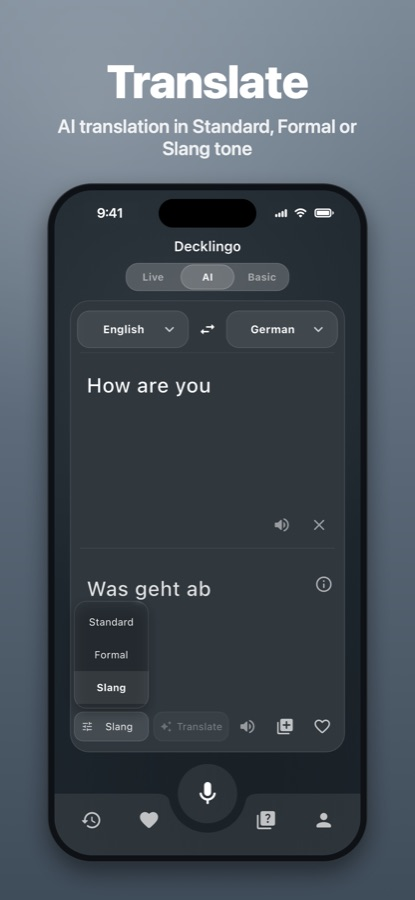
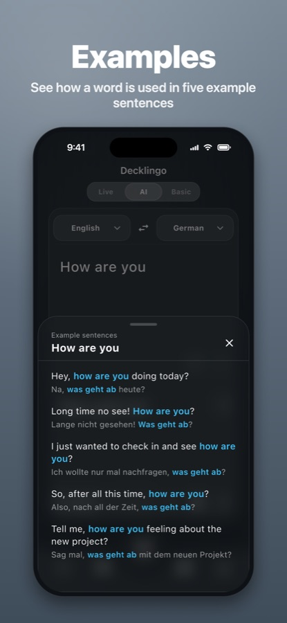
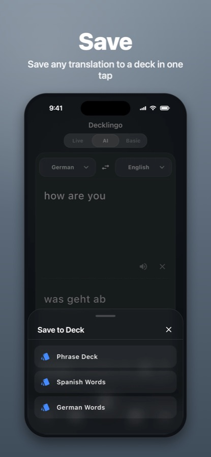
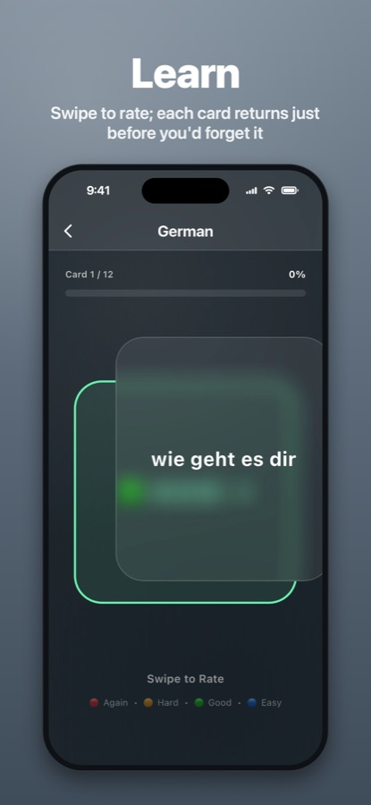
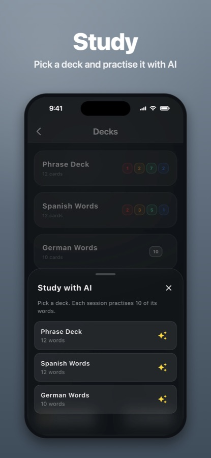
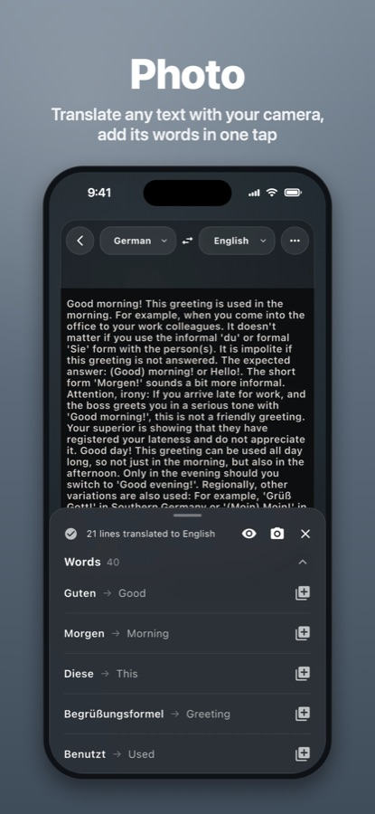

# Decklingo: AI Translate-Cards

**Translate with AI, save the words you meet and learn them with spaced repetition.**

[](https://apps.apple.com/app/id6824556221)

An iOS app I designed, built and shipped on my own: a Flutter client, a Node.js backend on Firebase, AI translation with Google Gemini, and in-app subscriptions.

<p>
  
  
  
  
  
  
</p>

## Features

- **AI translation** in Standard, Formal or Slang tone, with up to three alternatives
- **Example sentences**: five everyday sentences for any word, the word highlighted in both languages
- **Photo translation**: text is read on the device; only the text is sent, never the photo
- **Live translation**: speech translated as it is spoken, with captions (Gemini Live)
- **Decks and flashcards** with swipe-to-rate study and text-to-speech
- **Spaced repetition** based on SM-2: missed cards come back in the same session, reviews spread out by ease
- **Study with AI**: fill-in-the-blank sentences written by the AI, answers checked on the server
- **Works offline**, syncs across devices when signed in
- English and Turkish interface

## Architecture

```
Flutter app (iOS)                         Backend (Firebase Cloud Functions)
├─ Provider + MVVM, clean architecture    ├─ Express API, Firebase Auth on every route
├─ Isar local database (offline first)    ├─ PostgreSQL (Supabase) via Prisma
├─ Firestore sync per user                ├─ Per-plan quotas and rate limits in SQL
├─ ML Kit on-device text recognition      ├─ Gemini: translation, examples, study
└─ RevenueCat subscriptions               ├─ Short-lived tokens for Gemini Live
                                          └─ RevenueCat webhook keeps plans in sync
```

- **Plans are enforced on the server**: the plan is read from RevenueCat, never trusted from the client; usage is counted atomically per plan window.
- **API keys stay on the server**: the app gets short-lived tokens for live translation.
- **Privacy**: per-user Firestore rules, no user text in logs, full account deletion.

## Tech stack

Flutter · Dart · Isar · Cloud Firestore · Firebase Auth · ML Kit · RevenueCat · Node.js · Express · Firebase Cloud Functions · PostgreSQL · Prisma · Supabase · Google Gemini

## Quality

- 200+ unit and widget tests, run in CI with static analysis
- Security review and dependency audit before release

## Source code

The source code is private. I'm happy to walk through it or share access on request.

---

© 2026 Kadir Köroğlu. All rights reserved.
