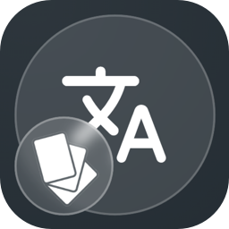
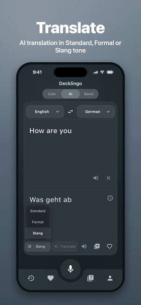
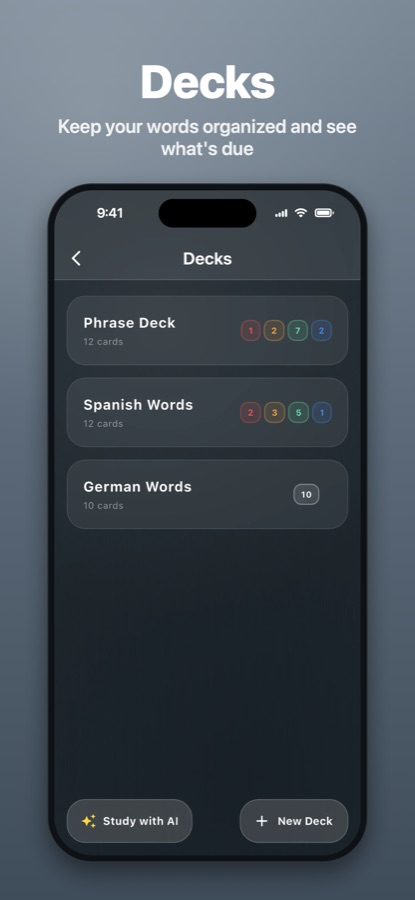
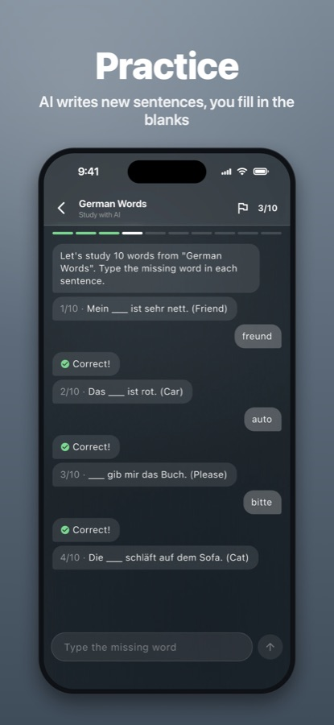
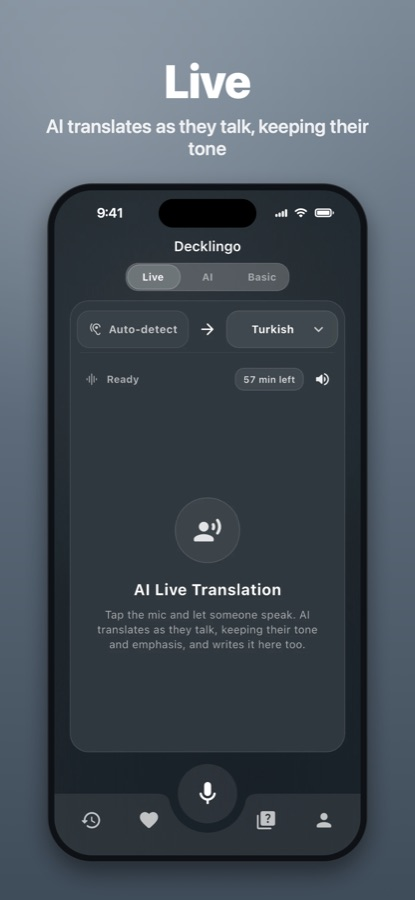

<div align="center">



# Decklingo: AI Translate-Cards

**Translate with AI, save the words you meet and learn them with spaced repetition.**

[](https://apps.apple.com/app/id6824556221)


An iOS app I designed, built and shipped on my own:<br>
a Flutter client, a Node.js backend on Firebase, AI with Google Gemini and in-app subscriptions.

<br>

<a href="media/decklingo-promo.mp4"></a>

<sub>▶ <a href="media/decklingo-promo.mp4">Watch the full promo video</a></sub>

</div>

<br>

## 📱 Screenshots

<table align="center">
  <tr>
    <td align="center"><br><b>Translate</b><br><sub>Standard, Formal or Slang</sub></td>
    <td align="center"><br><b>Examples</b><br><sub>Five sentences for any word</sub></td>
    <td align="center"><br><b>Photo</b><br><sub>Translate text from the camera</sub></td>
  </tr>
  <tr>
    <td align="center"><br><b>Save</b><br><sub>Any translation to a deck</sub></td>
    <td align="center"><br><b>Decks</b><br><sub>See what's due at a glance</sub></td>
    <td align="center"><br><b>Learn</b><br><sub>Swipe to rate each card</sub></td>
  </tr>
  <tr>
    <td align="center"><br><b>Study with AI</b><br><sub>Fill-in-the-blank practice</sub></td>
    <td align="center"><br><b>Practice</b><br><sub>Answers checked instantly</sub></td>
    <td align="center"><br><b>Live</b><br><sub>Speech translated as it's spoken</sub></td>
  </tr>
</table>

## ✨ Features

| | |
|---|---|
| 🌐 **AI translation** | Standard, Formal or Slang tone, with up to three alternatives |
| 💬 **Example sentences** | Five everyday sentences, the word highlighted in both languages |
| 📷 **Photo translation** | Text is read on the device; only the text is sent, never the photo |
| 🎙️ **Live translation** | Speech translated as it is spoken, with captions (Gemini Live) |
| 🗂️ **Decks & flashcards** | Swipe-to-rate study with text-to-speech |
| 🧠 **Spaced repetition** | SM-2 based: missed cards return in the same session, reviews spread out by ease |
| ✍️ **Study with AI** | Fill-in-the-blank sentences written by the AI, answers checked on the server |
| ☁️ **Offline first** | Works without internet, syncs across devices when signed in |
| 🇬🇧 🇹🇷 **Two languages** | English and Turkish interface |

## 🏗️ Architecture

```
┌──────────────────────────────┐   HTTPS + Firebase ID token   ┌──────────────────────────────────┐
│ Flutter app (iOS)            │ ────────────────────────────► │ Express API on Cloud Functions   │
│                              │                               │                                  │
│ • Provider + MVVM            │                               │ • Firebase Auth on every route   │
│ • Isar local DB, offline     │                               │ • PostgreSQL (Supabase) + Prisma │
│ • Firestore sync per user    │                               │ • Per-plan quotas in SQL         │
│ • ML Kit text recognition    │                               │ • Gemini: translate, examples,   │
│ • RevenueCat subscriptions   │                               │   study, Live tokens             │
└──────────────────────────────┘                               │ • RevenueCat webhook → plans     │
                                                               └──────────────────────────────────┘
```

- 🔒 **Plans are enforced on the server.** The plan is read from RevenueCat, never trusted from the client; usage is counted atomically per plan window.
- 🔑 **API keys stay on the server.** The app gets short-lived tokens for live translation.
- 🛡️ **Privacy by design.** Per-user Firestore rules, no user text in logs, full account deletion.

## ✅ Quality

- 200+ unit and widget tests, run in CI with static analysis
- Security review and dependency audit before release

## 🔐 Source code

The source code is private. I'm happy to walk through it or share access on request.

<br>

<div align="center"><sub>© 2026 Kadir Köroğlu. All rights reserved.</sub></div>
